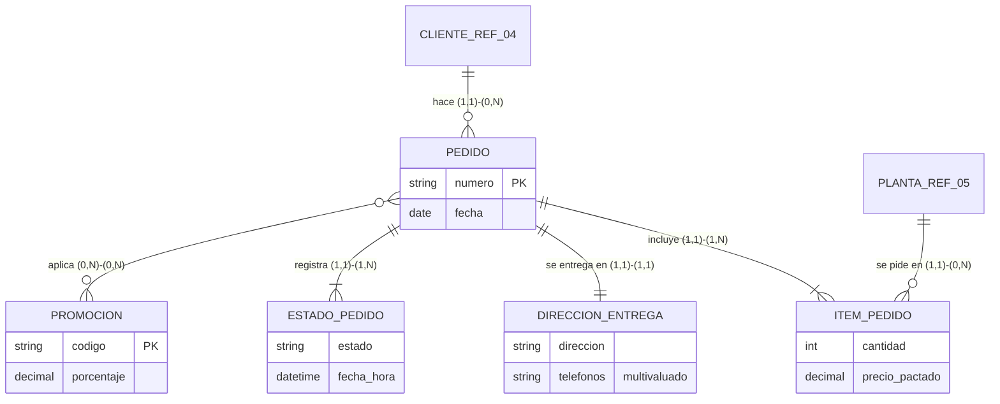
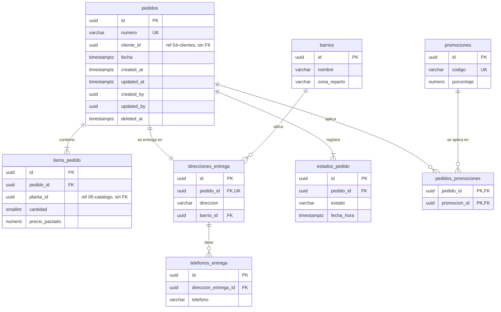

# Plantillas y ejemplos pequeños · Guía 1: Modelo de datos del software (v2)

**Ficha 3239188 · Análisis y Desarrollo de Software · Competencia 220501095 · RAP 593101**

Este archivo reúne los formatos que pide la guía y un ejemplo pequeño de cada uno en un dominio **distinto** de los proyectos de la ficha y de las pruebas: un **vivero comunitario** que vende plantas a domicilio. El ejemplo desarrolla un solo servicio, `03-pedidos`. Es un modelo de **forma**: tus artefactos salen de **tu** servicio, de tus requisitos y de tus tablas. Copiar el ejemplo no cuenta como artefacto entregado (Rubricas_G1.md, sección 1.5).

Los mínimos exigidos por aprendiz están en **Rubricas_G1.md**. El marco de gobierno de tu repositorio trae plantillas en inglés (`06-data/models.md`, `09-microservices/_template/service/data-model.md`); puedes escribir en español siguiendo la misma estructura.

---

## 0. Caso del ejemplo: «Vivero comunitario» (extracto del análisis)

| ID | Requisito |
|---|---|
| RF-01 | Registrar pedidos de plantas de un cliente, con una o más plantas y su cantidad. |
| RF-02 | Registrar la dirección de entrega del pedido y uno o más teléfonos de contacto para la entrega. |
| RF-03 | Aplicar una o más promociones vigentes a un pedido. |
| RF-04 | Llevar el historial de estados del pedido (recibido, alistado, despachado, entregado, anulado). |
| RNF-01 | Los datos de contacto del cliente solo los ven los roles autorizados. |
| RNF-02 | Ante una falla del servidor de datos se pierde, como máximo, una hora de pedidos. |

Catálogo del equipo (extracto): `01-api-gateway`, `02-auth-service`, `03-pedidos` (este ejemplo), `04-clientes` (dueño de los clientes) y `05-catalogo` (dueño de las plantas y sus precios de lista).

---

## 1. Rama, solicitud de integración y fila de propiedad

Antes de crear tu rama, el integrante designado por el equipo publica la **base común** (catálogo, `06-data/modeling-conventions.md` y los archivos compartidos con su estructura vacía) con una solicitud de integración que se fusiona en la sesión del 26 de noviembre. Después:

```bash
git switch dev                                  # o main, si el equipo no tiene dev
git pull
git switch -c g1/03-pedidos-usuario-ejemplo
# ... editar tus archivos ...
git add 06-data/G1-README-entrega.md
git commit -m "docs(g1): registra propiedad del servicio 03-pedidos"
git push -u origin g1/03-pedidos-usuario-ejemplo
```

Después, en GitHub: **New pull request** desde tu rama hacia `dev` (o `main`), con el título `G1 593101: 03-pedidos (usuario-ejemplo)`. No fusiones solicitudes de integración ajenas ni hagas `git push --force`.

---

## 2. Modelo conceptual (M1)

Entidades propias del servicio con sus atributos e identificador, relaciones con verbo y cardinalidad, y las entidades de otros servicios marcadas como **referencia externa** (no se modelan sus atributos: no son tuyas).



| Entidad | Identificador | Requisito | Observación |
|---|---|---|---|
| PEDIDO | numero | RF-01 | Propia |
| ITEM_PEDIDO | (pedido, planta) | RF-01 | Propia; atributo de la relación pedido–planta |
| DIRECCION_ENTREGA | pedido | RF-02 | Propia; `telefonos` es multivaluado |
| ESTADO_PEDIDO | (pedido, fecha_hora) | RF-04 | Propia |
| PROMOCION | codigo | RF-03 | Propia; N:M con PEDIDO |
| CLIENTE_REF_04 | cliente_id | RF-01 | **Referencia externa**: dueño `04-clientes` |
| PLANTA_REF_05 | planta_id | RF-01 | **Referencia externa**: dueño `05-catalogo` |

**Tipo de base de datos seleccionado:** relacional (los pedidos exigen transacciones completas y reglas de integridad entre pedido, ítems y estados).

---

## 3. Cuadro de reglas de transformación (M2)

| Regla | Dónde se aplicó | Resultado en el modelo lógico |
|---|---|---|
| Relación N:M → tabla intermedia | PEDIDO aplica PROMOCION | `pedidos_promociones(pedido_id FK, promocion_id FK)`, PK compuesta |
| Relación 1:N → FK en el lado «muchos» | PEDIDO registra ESTADO_PEDIDO | `estados_pedido.pedido_id` FK |
| Relación 1:1 → FK única | PEDIDO se entrega en DIRECCION_ENTREGA | `direcciones_entrega.pedido_id` FK UNIQUE |
| Atributo multivaluado → tabla aparte | `telefonos` de DIRECCION_ENTREGA | `telefonos_entrega(id, direccion_entrega_id FK, telefono)` |
| Entidad de otro servicio → referencia por identificador, **sin FK** | CLIENTE_REF_04, PLANTA_REF_05 | `pedidos.cliente_id`, `items_pedido.planta_id` (validados por API de `04-clientes` y `05-catalogo`) |
| Atributo de la relación → columna de la tabla que resuelve la relación | `cantidad`, `precio_pactado` | Columnas de `items_pedido` |

---

## 4. Modelo lógico relacional (M2)

Convención del ejemplo: tablas en plural y `snake_case`, identificador `UUID`, FK `<singular>_id`, fechas `TIMESTAMPTZ`, auditoría y borrado lógico en todas las tablas (ver sección 8). Para que el diagrama sea legible, las columnas de auditoría se muestran solo en `pedidos`; en las tablas de detalle se escriben todas.



Tabla en el formato del marco (una por tabla):

### Tabla: `items_pedido`

| Campo | Tipo | Nulo | Descripción | Restricciones |
|---|---|---|---|---|
| id | UUID | No | Identificador del ítem | PK |
| pedido_id | UUID | No | Pedido al que pertenece | FK → `pedidos.id` ON DELETE RESTRICT |
| planta_id | UUID | No | Planta pedida | Referencia a `05-catalogo` (sin FK; se valida por API) |
| cantidad | SMALLINT | No | Unidades pedidas | CHECK (cantidad BETWEEN 1 AND 50) |
| precio_pactado | NUMERIC(12,2) | No | Precio de la planta al momento del pedido | CHECK (precio_pactado > 0) |
| created_at, updated_at | TIMESTAMPTZ | No | Auditoría | DEFAULT NOW() |
| created_by, updated_by | UUID | Sí | Usuario que creó o modificó | |
| deleted_at | TIMESTAMPTZ | Sí | Borrado lógico | NULL = activo |

| Índice | Columnas | Consulta que lo justifica |
|---|---|---|
| `idx_items_pedido_pedido_id` | `pedido_id` | Mostrar los ítems de un pedido (cada vez que se abre un pedido) |
| `idx_pedidos_cliente_id_fecha` | `cliente_id`, `fecha` | Historial de pedidos de un cliente por rango de fechas |

**Decisión de modelado:** `precio_pactado` repite un dato que también existe en `05-catalogo`, pero no es redundancia: es el precio **en el momento del pedido** y depende del ítem, no de la planta. Se declara aquí para que nadie lo «normalice» por error.

---

## 5. Normalización paso a paso (M3)

**0FN:** `pedidos_plano(numero_pedido, fecha, cliente_id, planta_id, cantidad, precio_pactado, telefonos_contacto, barrio_id, nombre_barrio, zona_reparto)` con llave (`numero_pedido`, `planta_id`); `telefonos_contacto` trae varios valores separados por coma.

**Dependencias funcionales:**

- `numero_pedido → fecha, cliente_id, barrio_id`
- `barrio_id → nombre_barrio, zona_reparto`
- `(numero_pedido, planta_id) → cantidad, precio_pactado`

| Paso | Violación encontrada | Resultado |
|---|---|---|
| 1FN | `telefonos_contacto` no es atómico | `telefonos_entrega(id, direccion_entrega_id, telefono)`; la columna sale de la tabla |
| 2FN (dependencia parcial, llave compuesta) | `fecha`, `cliente_id` y `barrio_id` dependen solo de `numero_pedido` | `pedidos(numero, fecha, cliente_id, barrio_id)` e `items_pedido(numero_pedido, planta_id, cantidad, precio_pactado)` |
| 3FN (dependencia transitiva) | `numero_pedido → barrio_id → nombre_barrio, zona_reparto` | `barrios(id, nombre, zona_reparto)`; en el pedido queda solo `barrio_id` |

**Estado final:** sin dependencias parciales ni transitivas. En el modelo lógico de la sección 4, `barrio_id` quedó en `direcciones_entrega` (y no en `pedidos`) porque el modelo conceptual separa la dirección de entrega en una relación 1:1; el resultado sigue en 3FN. Si desnormalizas algo a propósito (un total precalculado, por ejemplo), lo justificas y declaras dónde.

---

## 6. Sección en `06-data/models.md` (índice del equipo)

```markdown
## Servicio: 03-pedidos

**Responsable:** @usuario-ejemplo · **Motor:** PostgreSQL 16 · **Modelo completo:** [data-model.md](../09-microservices/services/03-pedidos/data-model.md)

Tablas: pedidos, items_pedido, direcciones_entrega, telefonos_entrega, estados_pedido, promociones, pedidos_promociones, barrios.
```

---

## 7. Diccionario de datos (D1)

En `06-data/data-dictionary.md`, sección `## Servicio: 03-pedidos (@usuario-ejemplo)`:

| Tabla | Columna | Tipo | Tamaño | Nulo | Restricciones | Dominio / valores | Descripción | Dato personal |
|---|---|---|---|---|---|---|---|---|
| `pedidos` | `numero` | VARCHAR | 12 | No | UNIQUE | `PED-` + 8 dígitos | Número visible del pedido | No |
| `estados_pedido` | `estado` | VARCHAR | 12 | No | CHECK | RECIBIDO, ALISTADO, DESPACHADO, ENTREGADO, ANULADO | Estado en esa fecha | No |
| `telefonos_entrega` | `telefono` | VARCHAR | 15 | No | CHECK solo dígitos | 7 a 15 dígitos | Teléfono de contacto para la entrega | **Sí** |
| `items_pedido` | `precio_pactado` | NUMERIC | 12,2 | No | CHECK > 0 | Pesos colombianos | Precio al momento del pedido | No |

El diccionario debe coincidir con el modelo lógico: mismos nombres, tipos y restricciones.

---

## 8. Estándar de nombrado y modelado (D2)

El equipo lo declara una vez en `06-data/modeling-conventions.md`; cada aprendiz lo verifica sobre **todas** sus tablas en su `data-model.md`:

| # | Regla del equipo | Cumple en mis tablas | Corrección hecha |
|---|---|---|---|
| R1 | Tablas en plural y `snake_case` | Sí | `TelefonoEntrega` → `telefonos_entrega` |
| R2 | Columnas en `snake_case`, sin abreviaturas | Sí | |
| R3 | FK como `<singular>_id` | Sí | |
| R4 | Identificador `UUID` en todas las tablas con entidad propia; las tablas intermedias usan llave compuesta de sus FK | Sí | |
| R5 | Fechas con zona horaria (`TIMESTAMPTZ`) | Sí | `fecha` era `VARCHAR` |
| R6 | Auditoría (`created_at`, `updated_at`, `created_by`, `updated_by`) y borrado lógico (`deleted_at`) en todas las tablas | Sí | |
| R7 | Índices `idx_<tabla>_<columnas>` | Sí | |

---

## 9. Selección del motor (D3)

| Elemento | Contenido |
|---|---|
| Motor y versión | PostgreSQL 16 |
| Condición 1 | Un pedido, sus ítems y su primer estado se guardan juntos o no se guardan (transacción ACID) |
| Condición 2 | Reglas de integridad declarativas: FK internas, `CHECK` de cantidades, precios y estados |
| Condición 3 | Consultas por cliente y rango de fechas con índices compuestos |
| Alternativa descartada | Motor documental: el pedido tiene estructura estable y exige integridad entre tablas; la flexibilidad de esquema no aporta |
| Coherencia | Con `05-architecture` (servicio de dominio con persistencia propia) y con la guía de motores de `06-data/models.md` |

---

## 10. Políticas de seguridad de los datos (D4)

En `data-security.md` de tu servicio:

| Principio | Política | Medida concreta en mis tablas |
|---|---|---|
| Integridad | Reglas de dominio en la base | `CHECK` en `items_pedido.cantidad` y `precio_pactado`; `CHECK` de valores en `estados_pedido.estado` |
| Integridad | Trazabilidad de cambios | Auditoría en todas las tablas; los estados no se actualizan, se agrega una fila nueva en `estados_pedido` |
| Confidencialidad | Datos de contacto protegidos | `telefonos_entrega.telefono` cifrado en la columna y enmascarado para el rol `alistamiento` |
| Confidencialidad | Datos en tránsito | Conexión del servicio a su base y llamadas entre servicios solo por TLS |
| Disponibilidad | Respaldo acorde con RNF-02 | Respaldo incremental cada hora y completo diario, copia en otra ubicación |
| Disponibilidad | Restauración probada | Prueba de restauración mensual en un ambiente aparte, con registro del resultado |

Si tu servicio guarda credenciales (por ejemplo, `02-auth-service`), la contraseña se guarda con **hash y sal** (nunca cifrada de forma reversible ni en texto plano).

---

## 11. Matriz de roles contra tablas (D5)

| Rol | `pedidos` | `items_pedido` | `direcciones_entrega` | `telefonos_entrega` | `estados_pedido` | `promociones` |
|---|---|---|---|---|---|---|
| `app_pedidos` (usuario del servicio) | SELECT, INSERT, UPDATE | SELECT, INSERT, UPDATE | SELECT, INSERT, UPDATE | SELECT, INSERT, UPDATE | SELECT, INSERT | SELECT |
| `alistamiento` (consulta) | SELECT | SELECT | SELECT | SELECT enmascarado | SELECT | Sin acceso |
| `mercadeo` | Sin acceso | Sin acceso | Sin acceso | Sin acceso | Sin acceso | SELECT, INSERT, UPDATE |
| `migraciones` (solo despliegues) | DDL | DDL | DDL | DDL | DDL | DDL |

Mínimo privilegio: ningún rol tiene `DELETE` físico (se usa borrado lógico) y el usuario de la aplicación no es el mismo de las migraciones.

---

## 12. Tratamiento de datos personales (D5)

De acuerdo con la normativa colombiana de protección de datos personales:

| Columna | Finalidad | Autorización | Conservación | Quién accede | Medida de protección |
|---|---|---|---|---|---|
| `telefonos_entrega.telefono` | Coordinar la entrega del pedido | Casilla de autorización al confirmar el pedido | 6 meses después de entregado; luego se anonimiza | `app_pedidos`; `alistamiento` enmascarado | Cifrado en la columna y TLS |
| `direcciones_entrega.direccion` | Entregar el pedido | La misma autorización | 6 meses después de entregado | `app_pedidos`, `alistamiento` | TLS y acceso por rol |

---

## 13. Matriz de propiedad de los datos (D6)

En `09-microservices/data-ownership-matrix.md`:

| Entidad | Servicio dueño | Otros que guardan copia | Cómo se sincroniza | Responsable |
|---|---|---|---|---|
| Pedido | `03-pedidos` | `06-reportes` (resumen) | Evento `PedidoConfirmado` | @usuario-ejemplo |
| Estado del pedido | `03-pedidos` | Ninguno | API `GET /pedidos/{id}/estados` | @usuario-ejemplo |
| Promoción | `03-pedidos` | Ninguno | API | @usuario-ejemplo |
| Cliente | `04-clientes` | `03-pedidos` (solo `cliente_id`) | API `GET /clientes/{id}` | (otro aprendiz) |

Una entidad tiene **un solo** servicio dueño. Si tu fila choca con la de un compañero, lo resuelven antes del corte.

---

## 14. Entrega de la prueba de desempeño (en computador y en Moodle)

Al terminar los 90 minutos, comprime una carpeta con esta forma y súbela a la tarea de Moodle como `G1-desempeno-<variante>.zip` (no pongas tu nombre en los archivos):

```
G1-desempeno-<variante>/
  01-propiedad-y-conceptual.md
  02-normalizacion.md
  03-modelo-logico.md        (o 03-modelo-logico.sql)
  04-diccionario.md
  05-seguridad.md
```

Ve guardando cada archivo apenas lo termines; no dejes la normalización para el final.
